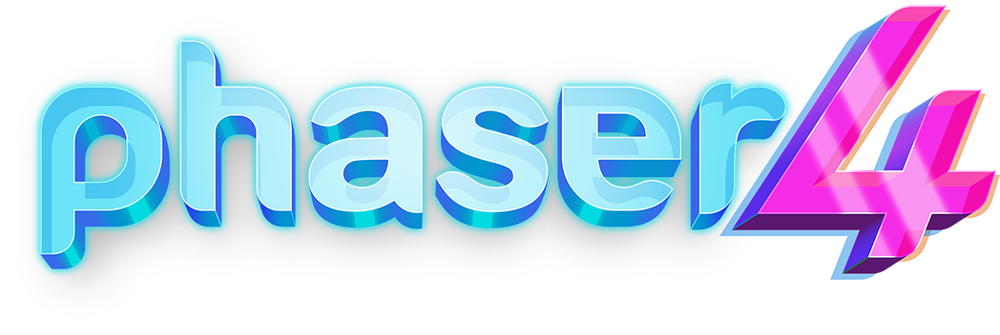

# SpriteCrate

English | [简体中文](README_CN.md)

A texture atlas packer for JavaScript projects, with a Node.js SDK and CLI.

Combine PNG sprites into texture atlases and export metadata for Phaser 4, PixiJS, and Cocos. Use it in your asset pipeline or work directly with RGBA pixels through the standalone core.

<p>
  <a href="https://phaser.io/"></a>&nbsp;&nbsp;&nbsp;
  <a href="https://pixijs.com/"></a>&nbsp;&nbsp;&nbsp;
  <a href="https://www.cocos.com/creator"></a>
</p>

## Features

- **Atlas packing** — five MaxRects strategies, automatic size search, multiple pages, fixed sizes, power-of-two dimensions, and square atlases.
- **Sprite processing** — transparent trimming, deduplication, optional 90° rotation, and edge extrusion.
- **Export formats** — Phaser 4/3, PixiJS multipack JSON, Cocos plist, generic JSON Hash/Array, and custom SDK exporters.
- **Build integration** — CLI, JSON configuration, dry runs, and machine-readable results.
- **TypeScript support** — type declarations and a core package with no Node.js or DOM dependencies.

## Supported frameworks

| Framework                     | Format    | Atlas rotation | Validation                                                                                  |
| ----------------------------- | --------- | -------------- | ------------------------------------------------------------------------------------------- |
| **Phaser 4** — primary target | `phaser4` | Disabled       | 4.2.1 · WebGL pixel comparison                                                              |
| Phaser 3                      | `phaser3` | Disabled       | 3.90.0 · WebGL pixel comparison                                                             |
| **PixiJS**                    | `pixijs`  | Supported      | 8.23.0 · WebGL pixel comparison                                                             |
| **Cocos Creator / Cocos2d-x** | `cocos2d` | Exported       | plist format 3 · metadata and pixel reconstruction tests; editor/runtime validation pending |

All targets support multiple pages and transparent trimming. PixiJS loads related pages automatically; Cocos emits one PNG/plist pair per page. Generic `json-hash` and `json-array` output is also available for custom loaders.

See [framework integration](docs/frameworks.md) for loading examples and validation scope. [Logo sources and licenses](docs/assets/frameworks/README.md).

## Quick start

Install the Node.js SDK:

```bash
npm install @spritecrate/node
```

Install the CLI (`@spritecrate/cli`; executable: `spritecrate`):

```bash
npm install --save-dev @spritecrate/cli
npx @spritecrate/cli pack "assets/**/*.png" --out-dir dist/atlas --format phaser4
```

Requires Node.js 22.18.0 or later. All packages are ESM.

## Usage

### CLI

Pack PNG files into a Phaser 4 atlas:

```bash
npx @spritecrate/cli pack "assets/**/*.png" \
  --out-dir dist/atlas \
  --name characters \
  --format phaser4
```

You can also use a JSON configuration file:

```json
{
  "inputs": ["assets/**/*.png"],
  "outDir": "dist/atlas",
  "format": "phaser4",
  "atlas": {
    "name": "characters",
    "maxWidth": 2048,
    "maxHeight": 2048,
    "trim": true,
    "extrude": 1
  }
}
```

Save it as `spritecrate.config.json` and run:

```bash
npx @spritecrate/cli pack --config spritecrate.config.json
```

Preview the output without writing files, or return a JSON report:

```bash
npx @spritecrate/cli pack --config spritecrate.config.json --dry-run
npx @spritecrate/cli pack --config spritecrate.config.json --json
```

Paths in a configuration file are relative to that file. Paths passed on the command line are relative to the current working directory. See the [configuration reference](docs/configuration.md) for all options.

### Node.js SDK

```ts
import { pack, writeOutput } from '@spritecrate/node';

const result = await pack({
  inputs: ['assets/**/*.png'],
  atlas: {
    name: 'characters',
    maxWidth: 2048,
    maxHeight: 2048,
  },
  format: 'phaser4',
});

await writeOutput(result.files, { directory: 'dist/atlas' });
```

`pack()` returns output files and statistics. `writeOutput()` writes those files to disk. You can also pass PNG bytes as `{ id, data: Uint8Array }`.

See [examples/node-basic.mjs](examples/node-basic.mjs) for a complete example.

### Phaser 4

Load the exported atlas with Phaser's `multiatlas` loader:

```js
// preload()
this.load.multiatlas('characters', 'dist/atlas/characters.json', 'dist/atlas/');

// create()
this.add.image(100, 100, 'characters', 'assets/hero.png');
```

Frame names preserve the input file's relative path and extension. Rotation must be disabled for Phaser 4 exports; see the limitations below.

### PixiJS

Export with `--format pixijs`, then load the first JSON page:

```js
import { Assets, Sprite } from 'pixi.js';

const sheet = await Assets.load('dist/atlas/characters.json');
const sheets = [sheet, ...sheet.linkedSheets];
const texture = sheets.map((page) => page.textures['assets/hero.png']).find(Boolean);
app.stage.addChild(new Sprite(texture));
```

For multiple pages, load `characters-0.json`; related pages load automatically. Cocos import instructions are in the [framework guide](docs/frameworks.md#cocos-creator--cocos2d-x).

### Packing quality

By default, `atlas.packMode: 'best'` tries multiple MaxRects strategies and candidate canvas sizes, then composites pixels once. It keeps page count and total area no larger than the `fast` baseline. Search has a deterministic work budget and does not guarantee a global optimum.

Set `atlas.packMode: 'fast'` in SDK options or JSON configuration to use the single-pass BSSF layout from 0.1.2. Fixed-size output retains its specified dimensions. See [packing behavior and benchmarks](docs/packing.md).

## Packages

| Package             | Purpose                                                          |
| ------------------- | ---------------------------------------------------------------- |
| `@spritecrate/core` | RGBA processing, atlas packing, compositing, and metadata export |
| `@spritecrate/node` | Node.js SDK with image codecs and file I/O                       |
| `@spritecrate/cli`  | Command-line tool, available as `spritecrate`                    |

Use `@spritecrate/core` on its own when you need to work directly with RGBA data.

Phaser 4 is the primary target. The `phaser3` export remains available for compatibility.

## Limitations

- Static PNG input and PNG output.
- The core and generic JSON exporters support rotation. Phaser 4/3 exports reject it because testing with Phaser 4.2.1 showed incorrect rendering of rotated frames.
- No GUI, watch mode, scaling, or migration of upstream GUI project files yet.

Output files are tracked in a manifest. Unrelated files and manually edited files are not overwritten. See the [configuration reference](docs/configuration.md) for output behavior and resource limits.

## Documentation

- [Migrating from SpriteTunk](docs/migration.md)
- [Configuration and export formats](docs/configuration.md)
- [Supported frameworks and loading](docs/frameworks.md)
- [Architecture](docs/architecture.md)
- [Upstream sources](docs/upstream.md)
- [Validation](docs/validation.md)

## Contributing

Issues and pull requests are welcome. See [CONTRIBUTING.md](CONTRIBUTING.md) for development guidelines.

Development requires Node.js `^22.22.2 || ^24.15.0 || ^26.0.0` and pnpm `10.34.7`. From the repository root:

```bash
pnpm install --frozen-lockfile
pnpm build
pnpm check
pnpm example
```

The example generates sample sprites and writes the atlas to `examples/output/`.

## Acknowledgments

This project draws on [odrick/free-tex-packer-core](https://github.com/odrick/free-tex-packer-core). Its MaxRects implementation is adapted from the upstream code in TypeScript; image-processing rules and export formats also reference that project. Product features are informed by [odrick/free-tex-packer](https://github.com/odrick/free-tex-packer). Thanks to the original author and contributors.

Adapted portions retain Copyright (c) 2018 Alexander Norinchak and the MIT license. See `THIRD_PARTY_NOTICES.md` and `LICENSES/` in each package.

## License

[MIT](LICENSE) © 2026 [iulo](https://github.com/iulo).

Attribution in your product documentation is appreciated, but is not an additional license requirement.
